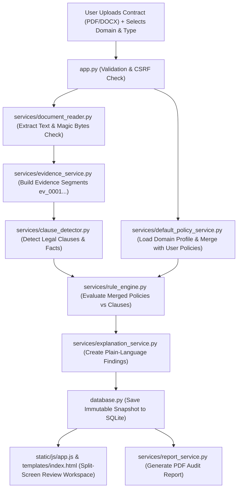

# ClauseLens — File Architecture & Component Guide

This document provides a simple, clear explanation of every important file in the **ClauseLens** project, explaining what each file does, why it exists, and how they connect together.

---

## 1. Application Core & Database

### [`app.py`](file:///C:/Users/swath/.gemini/antigravity-ide/scratch/ClauseLens/app.py)
- **Role:** Web Server & API Coordinator
- **Simple Explanation:** The main entry point for the Flask web application. It handles incoming web requests from the user's browser, routes them to the right functions, issues security tokens (CSRF protection), validates uploaded PDF and Word documents, coordinates document extraction, runs policy verification, and returns results to the user.

### [`database.py`](file:///C:/Users/swath/.gemini/antigravity-ide/scratch/ClauseLens/database.py)
- **Role:** Local SQLite Database Manager
- **Simple Explanation:** Manages local data storage using SQLite. It creates database tables, handles safe schema upgrades (Version 2) without losing old records, saves user policies and completed contract analyses, and automatically purges old records past the 30-day privacy retention period.

### [`config.py`](file:///C:/Users/swath/.gemini/antigravity-ide/scratch/ClauseLens/config.py)
- **Role:** Central Configuration Settings
- **Simple Explanation:** Holds all system-wide settings in one place, such as file upload limits (10 MB maximum), database file paths, retention periods (30 days), and optional settings for external AI connections (Nemotron).

---

## 2. Policy & Rule Verification Engine

### [`services/default_policy_service.py`](file:///C:/Users/swath/.gemini/antigravity-ide/scratch/ClauseLens/services/default_policy_service.py)
- **Role:** Domain-Specific Default Policy Library
- **Simple Explanation:** Contains a catalog of **48 built-in policy rules** tailored for 6 major contract domains (Government Documents, Tenders, Employment, Freelance/Service, NDAs, and Leases). It filters checks based on the selected document type and country/jurisdiction, clearly labels rules as either **Mandatory Requirements** (backed by official laws like GFR 2017 or the Contract Act) or **Recommended Review Checks**, and merges them with the user's custom policies.

### [`services/rule_engine.py`](file:///C:/Users/swath/.gemini/antigravity-ide/scratch/ClauseLens/services/rule_engine.py)
- **Role:** Deterministic Policy Evaluation Engine
- **Simple Explanation:** The "brain" that checks whether the document complies with the policies. It compares extracted clauses against rule parameters (such as "is payment term <= 30 days?" or "is automatic renewal prohibited?"). It generates clear findings (e.g., *Potential Conflict*, *Review Recommended*, or *No Conflict Detected*) and attaches the exact quotation and location.

### [`services/clause_detector.py`](file:///C:/Users/swath/.gemini/antigravity-ide/scratch/ClauseLens/services/clause_detector.py)
- **Role:** Clause & Fact Extraction Specialist
- **Simple Explanation:** Scans the text of the document looking for legal clauses using pattern matching and keyword cues (such as payment terms, renewal periods, liability caps, and governing law clauses). It extracts structured facts like numbers of days, jurisdiction names, and monetary limitations.

---

## 3. Document Processing, Evidence & Reporting

### [`services/document_reader.py`](file:///C:/Users/swath/.gemini/antigravity-ide/scratch/ClauseLens/services/document_reader.py)
- **Role:** Document Ingestion & Text Extractor
- **Simple Explanation:** Reads uploaded PDF and DOCX files safely. It checks file headers (magic bytes) to stop fake or malicious files, extracts text page by page (for PDFs) and paragraph by paragraph (for Word docs), and detects if a PDF is a scanned image with no readable text.

### [`services/evidence_service.py`](file:///C:/Users/swath/.gemini/antigravity-ide/scratch/ClauseLens/services/evidence_service.py)
- **Role:** Tamper-Proof Evidence Segmenter
- **Simple Explanation:** Splits the extracted contract text into numbered evidence chunks (`ev_0001`, `ev_0002`, ...). Each chunk records its exact character start and end positions, page number, and paragraph number so that any finding can be traced directly back to the original document without guesswork.

### [`services/explanation_service.py`](file:///C:/Users/swath/.gemini/antigravity-ide/scratch/ClauseLens/services/explanation_service.py)
- **Role:** Plain-Language Translator & Next-Step Advisor
- **Simple Explanation:** Formulates plain-English explanations and actionable next steps for the reviewer (e.g., *"Negotiate payment terms down to 30 days"*). It strictly adheres to policy verification language and never tells the user a contract is "safe" or "legal" (avoiding unauthorized legal advice).

### [`services/report_service.py`](file:///C:/Users/swath/.gemini/antigravity-ide/scratch/ClauseLens/services/report_service.py)
- **Role:** PDF Audit Report Generator
- **Simple Explanation:** Creates clean, downloadable PDF audit reports using ReportLab. It formats the document overview, domain classification, evaluated policies, evidence quotes, and findings table, complete with running page numbers and mandatory legal disclaimers.

### [`services/nemotron_service.py`](file:///C:/Users/swath/.gemini/antigravity-ide/scratch/ClauseLens/services/nemotron_service.py)
- **Role:** Optional AI Interpretation Adapter
- **Simple Explanation:** Provides an optional connection to NVIDIA Nemotron for ambiguous clauses where simple keyword rules are uncertain. It only runs if the user explicitly checks the opt-in box, and automatically falls back to local rules if offline.

---

## 4. User Interface & Frontend

### [`templates/index.html`](file:///C:/Users/swath/.gemini/antigravity-ide/scratch/ClauseLens/templates/index.html)
- **Role:** Single-Page Web Application Layout
- **Simple Explanation:** The HTML structure of the entire application. It contains the sidebar navigation, the metrics dashboard, the contract upload form with domain & document-type dropdowns, the dual policy checklists, the interactive split-screen review workspace, the policy editor modal, and the analysis history table.

### [`static/js/app.js`](file:///C:/Users/swath/.gemini/antigravity-ide/scratch/ClauseLens/static/js/app.js)
- **Role:** Frontend Interactivity & Logic
- **Simple Explanation:** Written in vanilla JavaScript with zero external libraries. It manages page switching (hash routing), file upload progress, dynamic updating of document types when a domain is picked, loading default policies, synchronized split-screen highlighting between finding cards and contract text, keyboard navigation, and history deletion.

### [`static/css/style.css`](file:///C:/Users/swath/.gemini/antigravity-ide/scratch/ClauseLens/static/css/style.css)
- **Role:** Styling & Design System
- **Simple Explanation:** Provides the visual design for ClauseLens. Uses a modern navy, slate, and white color palette, responsive grid layouts, status badges (red for conflicts, amber for reviews, green for compliant checks), mandatory/recommended tags, and print-ready stylesheets.

---

## 5. Automated Tests

All tests run locally using `pytest` (70 automated tests total):

### [`tests/test_default_policies.py`](file:///C:/Users/swath/.gemini/antigravity-ide/scratch/ClauseLens/tests/test_default_policies.py)
- **Simple Explanation:** Tests the domain-specific default policy feature. Verifies that all 6 domains and document types load correctly, jurisdiction filtering works (e.g. India vs foreign), invalid inputs are rejected (HTTP 422), default and user policies merge without losing either, and no image/OCR libraries are used.

### [`tests/test_api.py`](file:///C:/Users/swath/.gemini/antigravity-ide/scratch/ClauseLens/tests/test_api.py)
- **Simple Explanation:** Tests all backend web API endpoints, checking CSRF protection, file upload security, compliant and risky contract workflows, and PDF report downloads.

### [`tests/test_rule_engine.py`](file:///C:/Users/swath/.gemini/antigravity-ide/scratch/ClauseLens/tests/test_rule_engine.py)
- **Simple Explanation:** Tests that the rule engine correctly calculates payment deadlines, detects auto-renewal violations, flags unlimited liability, and generates proper finding categories.

### [`tests/test_clause_detector.py`](file:///C:/Users/swath/.gemini/antigravity-ide/scratch/ClauseLens/tests/test_clause_detector.py)
- **Simple Explanation:** Tests regex extraction of numbers, dates, payment periods, and governing law clauses from raw contract snippets.

### [`tests/test_document_reader.py`](file:///C:/Users/swath/.gemini/antigravity-ide/scratch/ClauseLens/tests/test_document_reader.py)
- **Simple Explanation:** Tests PDF and DOCX text extraction, corrupt file rejection, password protection detection, and scanned image warnings.

### [`tests/test_evidence.py`](file:///C:/Users/swath/.gemini/antigravity-ide/scratch/ClauseLens/tests/test_evidence.py)
- **Simple Explanation:** Tests evidence segment creation, verifying that evidence IDs (`ev_0001`) and character offsets are sequential and accurate.

### [`tests/test_policies.py`](file:///C:/Users/swath/.gemini/antigravity-ide/scratch/ClauseLens/tests/test_policies.py)
- **Simple Explanation:** Tests user policy management (creating, editing, disabling, and deleting user policies in SQLite).

### [`tests/test_report.py`](file:///C:/Users/swath/.gemini/antigravity-ide/scratch/ClauseLens/tests/test_report.py)
- **Simple Explanation:** Tests the ReportLab PDF report generation, page layout, and XML entity escaping.

### [`tests/test_nemotron.py`](file:///C:/Users/swath/.gemini/antigravity-ide/scratch/ClauseLens/tests/test_nemotron.py)
- **Simple Explanation:** Tests Nemotron AI opt-in logic, local mock server integration, and fallback to rules when offline.

### [`tests/conftest.py`](file:///C:/Users/swath/.gemini/antigravity-ide/scratch/ClauseLens/tests/conftest.py)
- **Simple Explanation:** Sets up isolated temporary SQLite databases and configured test clients for all automated tests.

---

## 6. Sample Data & Demonstration Contracts

### [`sample_contracts/generate_samples.py`](file:///C:/Users/swath/.gemini/antigravity-ide/scratch/ClauseLens/sample_contracts/generate_samples.py)
- **Simple Explanation:** A helper script that generates realistic sample contracts (PDF and DOCX) for testing and live demonstrations, including:
  - `risky_services_agreement.pdf` (has 60-day payment, auto-renewal, unlimited liability, NY jurisdiction)
  - `compliant_services_agreement.pdf` (meets 30-day payment, fee-capped liability, Indian jurisdiction)
  - `ambiguous_agreement.docx` (triggers review recommendations for human interpretation)
  - Edge cases such as password-protected, empty, and scanned-like PDFs.

---

## Architecture Summary Flow

